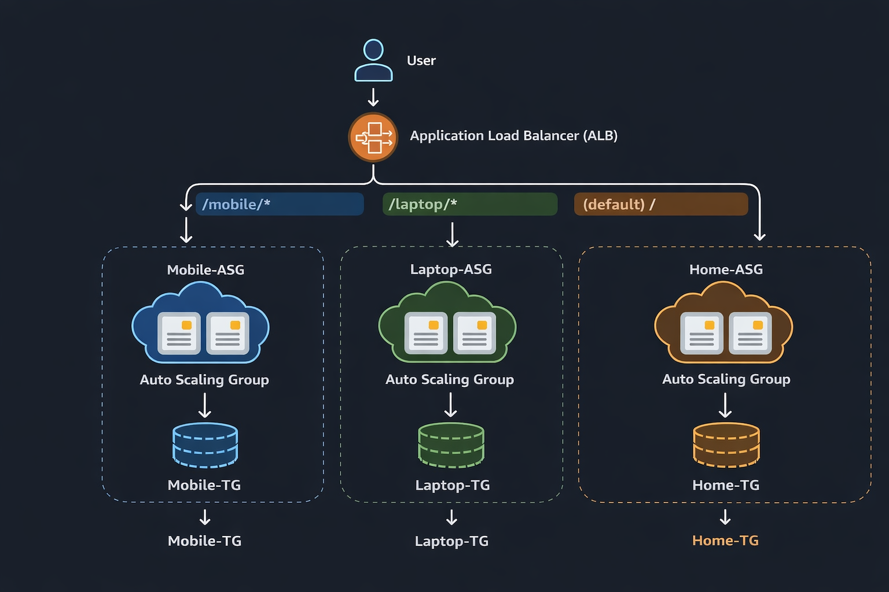
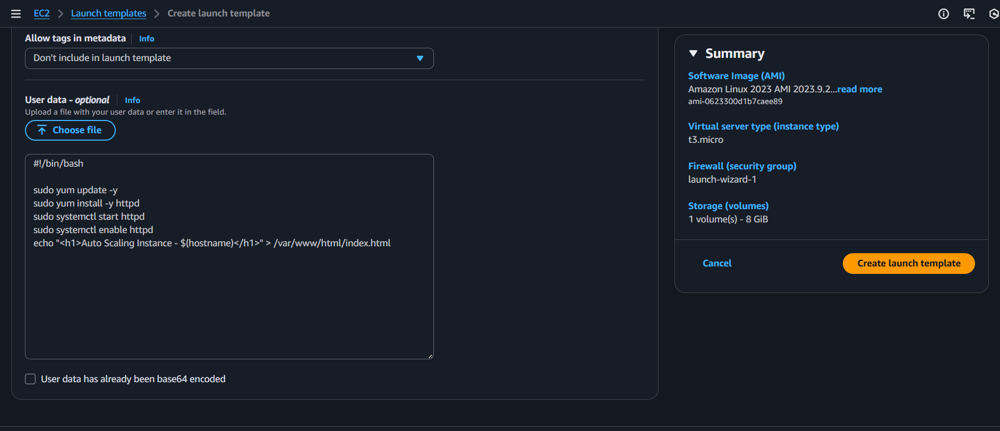
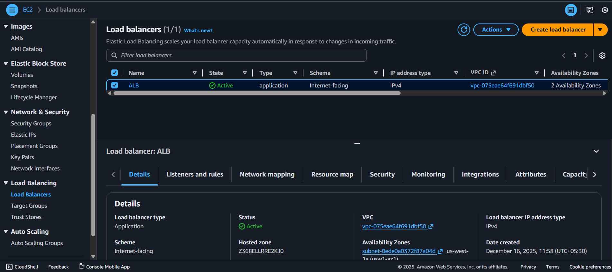
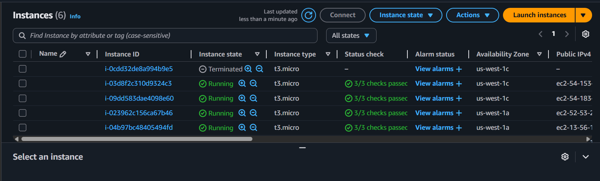

# Auto Scaling with Application Load Balancer (AWS)
This project demonstrates how to set up a highly available, scalable web application using Amazon Web Services (AWS) EC2 Auto Scaling and Elastic Load Balancing (ELB). The configuration automatically adjusts the number of running instances based on demand and distributes incoming traffic evenly across them.

## Table of Contents
*   [Overview](#overview)
*   [Architecture](#architecture)
*   [Deployment Steps](#deployment-steps)
*   [Testing the Setup](#testing-the-setup)
*   [Cleanup](#cleanup)
*   [Conclusion](#conclusion)

## Overview

In this project, I implemented Auto Scaling Groups with an Application Load Balancer (ALB)
to automatically scale EC2 instances based on traffic demand.

The architecture uses:
- Launch Templates
- Multiple Auto Scaling Groups
- Application Load Balancer
- Path-based routing
- Target Groups
- User Data scripts for automatic Apache setup

## Architecture

The following diagram represents the architecture of this project.
- Incoming user traffic is handled by an **Application Load Balancer (ALB)**.
- The ALB forwards requests to **Target Groups** based on path-based routing rules.
- Target Groups are associated with **Auto Scaling Groups (ASG)**.
- Auto Scaling Groups launch and terminate **EC2 instances** using a **Launch Template**.
- **User Data scripts** automatically install and configure Apache on EC2 instances.
- The architecture is deployed using the **Default VPC** across multiple Availability Zones.

This design ensures **high availability, scalability, and fault tolerance**.

## Deployment Steps
Detailed steps can be found in the accompanying deployment guide, but generally involve the following sequence:

1.  **Created a Launch Template:** Defines the EC2 instance configuration (AMI, instance type, user data script to install a web server).

2. **Created a Target Group:** Specifies where the Load Balancer will route traffic and defines health checks.

3.  **Created an Application Load Balancer:** Configured to listen for traffic and forward it to the Target Group.

4.  **Created an Auto Scaling Group:** Links the launch template and target group, defining the desired, minimum, and maximum capacity, along with scaling policies.

- Set up Scheduled Actions to scale EC2 instances automatically at predefined times.

5. **Launched EC2 instances automatically using the Launch Template, configured with Apache Web Server**

 
6. **Configured Listener Rules on the Load Balancer to route traffic based on path or host.**

## Testing the Setup
 **Access the application** using the DNS name of the Load Balancer.
 1. **Mobile page**

2. **Laptop page**

3. **Home page**

## Cleanup
To avoid ongoing charges, remember to delete all created resources:
*   Delete the Auto Scaling Group.
*   Delete the Load Balancer and Target Group.
*   Delete the Launch Template.
*   Delete any associated Security Groups or other infrastructure.

## Conclusion

The project successfully demonstrates an **AWS Auto Scaling architecture with an Application Load Balancer**.  

Key achievements:  
- EC2 instances are automatically launched and terminated based on traffic demand.  
- Traffic is efficiently distributed using the Load Balancer and Listener Rules.  
- Scheduled Actions ensure predictable scaling at predefined times.  
- The setup ensures **high availability, fault tolerance, and scalability** without manual intervention.  

This project provides hands-on experience with core AWS services like **EC2, Auto Scaling, Load Balancer, Target Groups, Launch Templates, and User Data scripts**, making it a valuable addition to any cloud portfolio.
